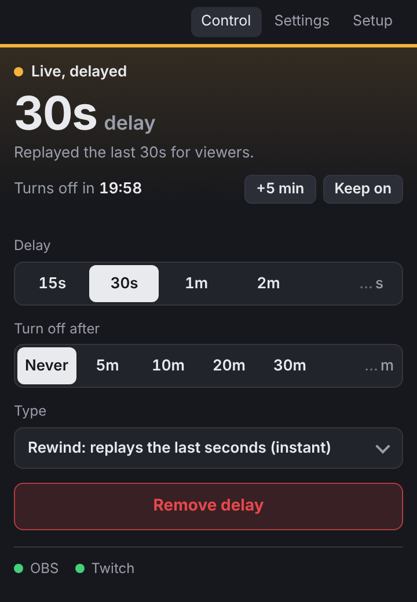

<div align="center">

# ⏱ Delay Bridge

**Add, change or remove your stream delay while you're live, without restarting your stream.**

Free and open source · one small `.exe` · works with OBS Studio and Streamlabs · Twitch, YouTube, Kick and any RTMP(S) platform

[](https://github.com/HolyJSP/delay-bridge/actions/workflows/ci.yml)
[](LICENSE)
[](https://github.com/HolyJSP/delay-bridge/releases/latest)



</div>

---

Stream snipers in your lobby? Press a hotkey and your stream goes to a **60-second delay for the next 20 minutes**. When you're done, press it again and viewers jump straight back to real time. **Your stream never goes offline, your VOD doesn't split, and you never touch OBS settings mid-game.**

OBS only lets you set its delay *before* you go live. Changing it means stopping the stream. Delay Bridge fixes that.

## Contents

- [Features](#features)
- [Quick start](#quick-start-5-minutes)
- [How it works](#how-it-works)
- [Controlling the delay](#controlling-the-delay)
- [Overlay mode](#overlay-mode)
- [Multistreaming](#multistreaming)
- [Configuration reference](#configuration-reference)
- [HTTP API](#http-api)
- [Performance](#performance)
- [Limitations and FAQ](#limitations-and-faq)
- [Security and privacy](#security-and-privacy)
- [Building from source](#building-from-source)
- [Contributing](#contributing)

Detailed guides: **[OBS setup guide](docs/OBS-SETUP.md)** · **[Troubleshooting](docs/TROUBLESHOOTING.md)** · **[How the delay works](docs/HOW-IT-WORKS.md)**

## Features

- 🎚 **Add, change or remove delay while live.** 15 s, 2 min or anything up to 1 hour, with no reconnect.
- ⏲ **Auto-off timer.** "Delay for 20 minutes" turns itself off when the timer ends. Extend it or keep it on with one click.
- 🔌 **OBS plugin with a built-in dock.** Delay Bridge starts and stops with OBS and shows up as a **Delay Bridge dock** inside OBS, with native **OBS hotkeys** and **Tools → Delay Bridge**. No separate window to manage.
- ⚡ **One-click setup from your OBS settings.** The plugin reads your Twitch/YouTube/Kick server and stream key straight from OBS and points OBS at Delay Bridge. One click undoes it.
- 📊 **Live OBS info in the dock:** whether OBS is going through Delay Bridge, encoder, bitrate, keyframe interval (with a warning if it's wrong for clean delay changes) and dropped frames.
- ⌨️ **Hotkeys everywhere.** Use OBS's own Hotkeys settings, a Stream Deck button, Bitfocus Companion, AutoHotkey or any tool that can open a URL.
- 🌊 **Gradual delay (default).** The delay builds up by playing the stream slower (30% by default) and comes off by playing faster. Viewers never see a pause or a jump. Voices keep their normal pitch.
- ⏪ **Rewind: instant delay with no freeze.** Turn on 30 s and viewers immediately see the last 30 s again, then carry on 30 s behind. Works for any amount up to the rewind memory (2 min by default). Removing it jumps straight back to live.
- 🖼 **Or change it instantly with a still picture:** viewers see a frozen frame, or a scene you design ("Delay on, back in 60 s"), while the delay builds up.
- 📡 **Multistream.** Send the same delayed stream to Twitch, YouTube and Kick at once.
- 🔁 **Survives network drops.** Reconnects to the platform automatically.
- 🏁 **Ends cleanly.** If you stop streaming while delayed, viewers still see the last N seconds.
- 🪶 **Tiny and light.** A 2.5 MB program using under 1% of one CPU core and ~4 MB of RAM (plus the delay buffer). It never decodes or re-encodes your video. Audio is only re-encoded while a gradual change is in progress.
- 🔒 **Local only.** Listens only on your own PC by default. Your stream keys never leave your machine except to go to your platform.
- 🧩 **No install, no account, no telemetry.** One file, MIT-licensed.

## Quick start (5 minutes)

> Full walkthrough with every OBS menu: **[docs/OBS-SETUP.md](docs/OBS-SETUP.md)**

Download the zip for your system from [**Releases**](https://github.com/HolyJSP/delay-bridge/releases/latest), or [build it yourself](#building-from-source), then pick one of these:

### Option A: OBS plugin (recommended)

Delay Bridge then lives inside OBS: a **Delay Bridge dock**, native hotkeys, **Tools → Delay Bridge**. It starts and stops with OBS, and it can set itself up from the stream settings you already have in OBS.

1. **Close OBS.**
2. Open the `obs-plugin` folder and either:
   - **drag the plugin folder into OBS's plugins folder:**

     | OS | Drag this | Into |
     |---|---|---|
     | Windows | `obs-delay-bridge` | `C:\ProgramData\obs-studio\plugins` (paste into Explorer's address bar; create `plugins` if it's missing) |
     | macOS | `obs-delay-bridge.plugin` | `~/Library/Application Support/obs-studio/plugins` |
     | Linux | `obs-delay-bridge` | `~/.config/obs-studio/plugins` (Flatpak: `~/.var/app/com.obsproject.Studio/config/obs-studio/plugins`) |

   - or run **`install-obs-plugin.bat`** (Windows) / **`./install-obs-plugin.sh`** (macOS/Linux), which copies it there for you.
3. **Start OBS.** A **Delay Bridge** dock appears (also under **Docks → Delay Bridge**).
4. In the dock, click **Use Delay Bridge with my Twitch settings** (or YouTube, Kick…). This copies your server and stream key from OBS into Delay Bridge and points OBS at Delay Bridge. That's the whole setup; skip the next section.
5. Recommended: set the [keyframe interval](#point-obs-at-delay-bridge) to 2 s. The dock warns you if it isn't.

### Option B: standalone program

1. Unzip anywhere, for example `Documents\Delay Bridge`, and run **`delay-bridge.exe`**. The dashboard opens in your browser.
   *Windows SmartScreen may warn about an unrecognized app because the exe isn't code-signed. Click **More info → Run anyway**, or build it yourself from this source.*
2. Under **Settings**, paste your platform's server URL and stream key and click **Save**. Keep the small Delay Bridge window open while you stream.

### Point OBS at Delay Bridge

*(The plugin's one-click setup does step 1 for you.)*

1. In OBS → **Settings → Stream**: Service **Custom…**, Server `rtmp://127.0.0.1:1935/live`, Stream Key `live` (anything works).
2. In **Settings → Output**, set **Output Mode** to **Advanced**, then on the **Streaming** tab set **Keyframe Interval** to **2** s. In Simple mode or at 0 (auto), the interval can be 8 s or more, which makes delay changes imprecise.
3. In **Settings → Advanced**, make sure **Stream Delay** is **unchecked**.
4. Click **Start Streaming** in OBS as usual. 🎉

| Platform | Server URL | Where's my key? |
|---|---|---|
| Twitch | `rtmp://live.twitch.tv/app` | Creator Dashboard → Settings → Stream → Primary Stream key |
| YouTube | `rtmp://a.rtmp.youtube.com/live2` | YouTube Studio → Create → Go live → Stream → Stream key |
| Kick | the `rtmps://…/app` URL from your Kick dashboard | Kick Creator Dashboard → Settings → Stream URL & Key |
| Other | any `rtmp://` or `rtmps://` URL | your platform's stream settings |

## How it works

```
               rtmp://127.0.0.1:1935                        rtmp(s)://
 ┌───────────┐  encoded video  ┌──────────────────────┐  same video, N s later  ┌──────────────────┐
 │ OBS /     │ ──────────────▶ │ Delay Bridge         │ ──────────────────────▶ │ Twitch / YouTube │
 │ Streamlabs│                 │ (on your PC)         │                         │ / Kick / …       │
 └───────────┘                 │ holds the packets in │                         └──────────────────┘
                               │ memory for N seconds │
                               └──────────────────────┘
```

Delay Bridge acts as a tiny local streaming server. OBS streams to it, and it forwards the stream to your platform, holding each packet for as long as you choose. Video is never decoded or re-encoded, so there's no quality loss.

- **Gradually (default):** to add 30 s at the default 30%, the stream plays at 0.7× speed for about 100 seconds until viewers are 30 s behind, then returns to normal speed. Removing it plays at 1.3× until viewers are back to live. Video frames are simply spaced further apart or closer together; audio is time-stretched with the pitch kept the same. Bigger ramp percentages are faster but more noticeable.
- **Rewind:** Delay Bridge keeps the last couple of minutes it already sent. To add 30 s, it restarts the output at the keyframe from 30 s ago, so viewers see those 30 s again (a replay) and are now 30 s behind, with no pause and no slow-motion. It lands on a keyframe, so the delay can end up a fraction of a second longer than asked (up to one keyframe interval). If you ask for more than the memory holds, it rewinds what it has and adds the rest gradually.
- **Frozen frame / Overlay, turning delay on or up:** the platform needs N extra seconds of video while the buffer fills. Viewers see a **frozen frame** (or your **overlay scene**) with silent audio, then the delayed stream continues from where it left off. This works whatever OBS's keyframe interval is.
- **Frozen frame / Overlay, turning delay off or down:** viewers skip ahead to near-live. The buffered seconds they hadn't seen yet are dropped.
- Timestamps are rewritten so the platform always sees **one continuous stream**. No reconnect, no "stream offline", no split VOD.

More detail in [docs/HOW-IT-WORKS.md](docs/HOW-IT-WORKS.md).

## Controlling the delay

| Method | Needs | Best for |
|---|---|---|
| **OBS hotkeys** | the OBS plugin (or OBS WebSocket) | Toggling mid-game with one key |
| **Stream Deck / Companion / Touch Portal** | nothing extra | A dedicated button per action |
| **Dashboard** at `http://127.0.0.1:8080` | a browser tab or OBS dock | Setup, picking delay and timer, seeing status |
| **HTTP API** | anything that can open a URL | AutoHotkey, scripts, bots |

### OBS hotkeys (recommended)

**With the OBS plugin:** open **OBS → Settings → Hotkeys**, type **Delay Bridge** in the filter box, and set keys for any of:

| Hotkey | Does |
|---|---|
| Delay Bridge: Toggle delay | On with your default delay and auto-off; off if already on |
| Delay Bridge: Turn on delay | On with your defaults, or restart the timer |
| Delay Bridge: Remove delay | Back to real time |
| Delay Bridge: Add 5 minutes to timer | Extend the auto-off timer |

Set the default delay and auto-off in the dashboard under **Settings → Delay options**.

**Without the plugin** (standalone program), you can still use an OBS hotkey through OBS's WebSocket server:

1. **OBS → Tools → WebSocket Server Settings** → tick **Enable WebSocket server** → click **Show Connect Info** and copy the password.
2. **Delay Bridge dashboard → Settings → OBS control** → tick **Connect to OBS WebSocket**, paste the password, **Save**.
3. In OBS, add an empty **Text** source named exactly **`Delay Toggle`** to the scene(s) you play in.
4. **OBS → Settings → Hotkeys** → give **Show 'Delay Toggle'** and **Hide 'Delay Toggle'** the **same key**. Each press toggles the delay.

### Stream Deck

Use the built-in **System → Website** action, tick **"GET request in background"**, and use one of these URLs:

| Button | URL |
|---|---|
| 60 s delay for 20 min | `http://127.0.0.1:8080/api/on?seconds=60&minutes=20` |
| 2 min delay, overlay mode | `http://127.0.0.1:8080/api/on?seconds=120&mode=overlay` |
| Remove delay | `http://127.0.0.1:8080/api/off` |
| Toggle (default delay) | `http://127.0.0.1:8080/api/toggle` |
| +5 min on the timer | `http://127.0.0.1:8080/api/extend?minutes=5` |

The same URLs work in Bitfocus Companion (Generic HTTP), Touch Portal, LioranBoard, Streamer.bot (Fetch URL), etc.

### AutoHotkey example

```autohotkey
; F9 toggles a 60 s delay that auto-removes after 20 minutes
F9::Run, curl -s "http://127.0.0.1:8080/api/toggle?seconds=60&minutes=20",, Hide
```

### Dashboard as an OBS dock

**With the plugin**, the **Delay Bridge** dock is added automatically the first time OBS starts. Show or hide it from **Docks → Delay Bridge**, and drag it wherever you like. If you remove it, it stays removed. To add it back: **Docks → Custom Browser Docks**, Name `Delay Bridge`, URL `http://127.0.0.1:8080/`.

**Standalone program:** add it the same way via **Docks → Custom Browser Docks**.

The dock uses ~0.5% of a CPU core while visible and nothing while hidden. Skip it if you prefer hotkeys.

### Taking stream settings from OBS (plugin)

The dock's **OBS** card shows how OBS is set up:
- **OBS streams directly to Twitch:** the delay can't apply. Click **Use Delay Bridge with my Twitch settings** to copy the server and key into Delay Bridge and point OBS at it. If you're live, OBS uses the new setting the next time you start streaming.
- **OBS streams through Delay Bridge:** all good. **Stream directly instead** puts OBS's original settings back exactly as they were.
- While live, it shows OBS's encoder, bitrate, keyframe interval and dropped frames.

**Settings → Import from OBS** copies the server and key without changing OBS. The stream key travels only over a private pipe between OBS and Delay Bridge; it never appears in the dashboard.

## Overlay mode

Instead of a frozen frame, viewers can see a scene you designed while the delay builds up.

1. Create an OBS scene, for example **`Delay Overlay`**, with an **Image** or **Text** source ("⏱ Delay activated, back in a moment"). Avoid Browser sources there if you want the lightest setup.
2. Turn on OBS WebSocket: in OBS, **Tools → WebSocket Server Settings → Enable WebSocket server**, then copy the password from **Show Connect Info** into the dashboard's **Settings → OBS control**. Overlay mode needs this even with the plugin. Then choose the scene under **Settings → Overlay scene**.
3. Pick **"Your overlay scene"** on the dashboard, or add `mode=overlay` to your Stream Deck URL.

When you add delay, Delay Bridge briefly switches OBS to that scene (about 1–2 s) to capture one frame, then switches back to your game scene. Viewers see that frame until the delayed stream starts. A **Cut** transition gives the cleanest capture.

### "Delay on" badge for viewers (optional)

Add a **Browser Source** with URL `http://127.0.0.1:8080/overlay` (transparent background). It shows a small badge only while a delay is active. Options: `?position=top-left|top-right|bottom-left|bottom-right&text=Delay%20{delay}`.

## Multistreaming

Add more destinations in **Settings → Where to stream** (Twitch + YouTube + Kick…). Each one gets the same delayed stream, has its own on/off switch, and reconnects independently if it drops. Your upload bandwidth must cover all of them: three destinations at 6 Mbps need about 18 Mbps of upload.

## Configuration reference

The dashboard edits the settings for you. They're stored in `config.json` (see [`config.example.json`](config.example.json)):

- **OBS plugin:** in OBS's plugin settings folder. Windows: `%APPDATA%\obs-studio\plugin_config\obs-delay-bridge\config.json`. macOS: `~/Library/Application Support/obs-studio/plugin_config/obs-delay-bridge/`. Linux: `~/.config/obs-studio/plugin_config/obs-delay-bridge/`. A log file, `delay-bridge.log`, sits next to it.
- **Standalone program:** next to `delay-bridge.exe`, created on first run.

| Key | Default | Meaning |
|---|---|---|
| `ingest.host` | `127.0.0.1` | Where OBS connects. Use `0.0.0.0` for a two-PC setup (see the OBS guide). |
| `ingest.port` | `1935` | RTMP port for OBS. |
| `ingest.streamKey` | `""` | If set, OBS must use this exact stream key. |
| `web.host` / `web.port` | `127.0.0.1` / `8080` | Dashboard and API address. |
| `web.openOnStart` | `true` | Standalone program: open the dashboard when it starts. (The plugin only opens it while no stream key is set.) |
| `destinations[]` | Twitch | `name`, `url`, `key`, `enabled` for each platform. |
| `delay.presets` | `[15,30,60,120]` | Quick delay buttons (seconds). |
| `delay.defaultSeconds` | `60` | Delay used by the hotkey and `/api/toggle` without `seconds`. |
| `delay.defaultDurationMinutes` | `0` | Auto-off for the hotkey; `0` means stay on until removed. |
| `delay.durationPresets` | `[5,10,20,30]` | Auto-off buttons (minutes). |
| `delay.maxSeconds` | `600` | Upper limit (5–3600). Memory ≈ bitrate × delay. |
| `delay.defaultMode` | `gradual` | `gradual` (speed ramp), `rewind` (replay), `instant` (frozen frame) or `overlay`. Also used by the auto-off timer and hotkeys. |
| `delay.rewindSeconds` | `120` | How much already-sent stream Rewind can replay (0 = off). Memory ≈ bitrate × this (about 90 MB at 6000 kbps for 120 s). |
| `delay.rampPercent` | `30` | How much slower/faster playback runs during a gradual change (2–50). 30% adds 3 s of delay every 10 s; 10% is subtler but takes 3× as long. |
| `delay.fillerFps` | `2` | Frame rate of the frozen frame while the delay builds up. |
| `obs.enabled` | `false` | Connect to OBS WebSocket. |
| `obs.url` / `obs.password` | `ws://127.0.0.1:4455` | From OBS → Tools → WebSocket Server Settings. |
| `obs.overlayScene` | `""` | Scene captured in overlay mode. |
| `obs.triggerSource` | `Delay Toggle` | Showing or hiding a source with this name toggles the delay. |

You can pass a different config path as the first argument: `delay-bridge.exe D:\stream\delay.json`.

## HTTP API

Every endpoint accepts **GET** with a query string, or **POST** with a JSON body and `Content-Type: application/json`. All of them return the current status as JSON.

| Endpoint | Parameters | Action |
|---|---|---|
| `/api/on` (alias `/api/delay`) | `seconds`, `minutes` (auto-off, 0 = never), `mode` (`instant`/`overlay`) | Turn delay on or change it |
| `/api/off` | – | Remove delay |
| `/api/toggle` | same as `/api/on` | On if off, off if on |
| `/api/extend` | `minutes` (default 5) | Add time to the auto-off timer |
| `/api/clear-timer` | – | Keep the delay on with no timer |
| `/api/status` | – | Current state |
| `/api/end-now` | POST only | After OBS stops: drop the remaining buffered video |
| `/api/config` | GET / POST | Read settings (keys hidden) / save settings |

## Performance

Measured with a 1080p60, 8 Mbps stream:

| | CPU (one core) | RAM |
|---|---|---|
| Running, not streaming | ~0% | ~3 MB |
| Streaming, no delay | ~0.7% | ~4 MB |
| Streaming, 60 s delay | ~0.9% | ~64 MB (the buffered video) |

The OBS plugin itself is a ~400 KB library that loads in about 1 ms and does nothing until you press a hotkey. Delay Bridge runs on a single thread, sleeps until the next batch of video is due, and does no work while you're offline. The delay buffer needs roughly **bitrate × delay**: 8 Mbps × 60 s ≈ 60 MB.

## Limitations and FAQ

**Is the delay exact?**
Changes snap to keyframes, which is why the Keyframe Interval should be 2 s (OBS → Settings → Output, Advanced mode). OBS's default "auto" can mean 8 s or more between keyframes; the plugin's dock warns you when that's the case. With a 2 s interval, a change can land up to 2 s off what you asked for; for example, after removing the delay, viewers may be 0–2 s behind instead of 0.

**Does it add to Twitch's normal latency?**
Yes. A 60 s delay means viewers are about 60 s plus the platform's usual 2–5 s behind.

**What do viewers see when I add delay?**
In **Gradually** mode (the default), nothing unusual: the stream just plays 30% slower until the delay is built up. How long it takes: delay ÷ ramp% (e.g. 30 s at 30% ≈ 100 s, 60 s at 30% ≈ 3 min 20 s, 30 s at 10% ≈ 5 min). Removing it takes the same time at 30% faster. If you want it less noticeable, lower Settings → Gradual speed to 10–20%.

In **Rewind** mode: an instant replay of the last N seconds, then the stream continues N seconds behind. Nothing freezes or slows down, but anyone watching closely sees the same moments twice.

In **Frozen frame** or **Overlay** mode: a still picture with silence for as many seconds as you added: your overlay scene, a frozen frame, or (if OBS's keyframes are far apart) the video simply paused on the last frame and continuing from exactly that point. When you remove delay, the stream keeps playing and skips forward at the next keyframe.

**Gradual mode takes too long, can I go faster?**
Yes: Settings → Gradual speed (up to 50%), or use **Rewind** for that one change: it's instant. Each change can use a different mode.

**Does my VOD or clip break?**
No. The platform sees one continuous stream. The VOD contains the frozen or overlay section where the delay was added.

**Twitch Enhanced Broadcasting / multitrack video?**
That only works with OBS's built-in Twitch service. When OBS streams to a custom server (Delay Bridge), it sends a normal single-quality stream, which is what you want here.

**Which codecs work?**
H.264 + AAC, the OBS default for every platform, is fully supported. HEVC/AV1 over Enhanced RTMP are passed through, but the frozen-frame filler for them is best-effort.

**Can I use OBS's own Stream Delay too?**
Turn it off. Delay Bridge replaces it, and having both stacks the delays.

**I removed the dock. How do I get it back?**
**Docks → Custom Browser Docks** → Name `Delay Bridge`, URL `http://127.0.0.1:8080/`.

**Does the plugin change my OBS settings?**
Only when you click **Use Delay Bridge with my … settings** (it sets OBS's stream server to Delay Bridge) or **Stream directly instead** (it puts your original setting back). It also adds the dock once.

**What happens if OBS crashes?**
With the plugin, Delay Bridge notices immediately and shuts itself down, so nothing is left running in the background. When you restart OBS, it starts again.

**Do the plugin and the standalone program share settings?**
No. They keep separate `config.json` files (see [Configuration reference](#configuration-reference)). Copy the file across if you switch.

**Does it work with Streamlabs Desktop?**
Yes. See the [OBS setup guide](docs/OBS-SETUP.md#streamlabs-desktop).

More in [docs/TROUBLESHOOTING.md](docs/TROUBLESHOOTING.md).

## Security and privacy

- The OBS input and the dashboard listen **only on `127.0.0.1`** (your own PC) unless you change them.
- The dashboard rejects requests addressed to other host names, which blocks DNS-rebinding attacks. Settings can only be changed with a JSON request, which other websites can't send silently.
- Stream keys are stored in `config.json` beside the exe and only ever sent to the platform you configured. The dashboard never displays them again after saving. `config.json` is git-ignored, so don't share it.
- No analytics, no update checks, no outbound connections other than to your platforms and your own OBS.

## Building from source

Anyone can build Delay Bridge themselves. It takes a few minutes the first time.

### Windows

1. Install Rust: download and run **rustup-init.exe** from <https://rustup.rs> and accept the defaults. If it offers to install the *Visual Studio C++ Build Tools*, say yes.
2. Download this repository (**Code → Download ZIP**) and unzip it, or `git clone https://github.com/HolyJSP/delay-bridge`.
3. Double-click **`build.bat`**. It builds the program and the OBS plugin, then asks whether to install the plugin into OBS right away.
4. Everything ends up in **`dist\`**:
   - `delay-bridge.exe`: the standalone program
   - `obs-plugin\obs-delay-bridge\`: the OBS plugin, ready to drop into `C:\ProgramData\obs-studio\plugins`
   - `obs-plugin\install-obs-plugin.bat`: copies it there for you

### macOS / Linux

```bash
curl --proto '=https' --tlsv1.2 -sSf https://sh.rustup.rs | sh    # install Rust, once
git clone https://github.com/HolyJSP/delay-bridge
cd delay-bridge
./build.sh                # → dist/delay-bridge, and the drop-in plugin in dist/obs-plugin/
                          #   (obs-delay-bridge.plugin on macOS, obs-delay-bridge/ on Linux)
```

### Running the tests

`build.bat test` (Windows) or `./build.sh test` (macOS/Linux) runs the unit tests and the end-to-end tests. The end-to-end tests need [ffmpeg](https://ffmpeg.org/download.html) on your PATH and take about 2 minutes.

Prefer plain Cargo? `cargo build --release` and `cargo test --release -- --test-threads=1` do the same thing.

Official downloads are built by GitHub Actions ([`.github/workflows/release.yml`](.github/workflows/release.yml)) whenever a `v*` tag is pushed. CI runs the full test suite and both build scripts on Windows, macOS and Linux for every push.

### Project layout

```
src/
  main.rs          startup, ports, Ctrl+C
  app.rs           timers, settings, OBS control, status: the glue
  engine.rs        the delay buffer, filler frames, timestamp rewriting
  output.rs        one task per destination: connect, reconnect, batch writes
  obs.rs           obs-websocket v5 client (scene switching, hotkey trigger)
  web.rs           tiny HTTP server for the dashboard and API
  media.rs         FLV/H.264/AAC packet inspection, silent AAC frames
  stretch.rs       pitch-preserving audio time-stretch (WSOLA) + AAC decode/re-encode for ramps
  amf0.rs          AMF0 encoding (RTMP commands)
  rtmp/            chunk stream, handshake, ingest server, publisher (RTMP + RTMPS)
public/            dashboard and viewer badge (embedded into the exe)
tests/e2e.rs       ffmpeg → bridge → local RTMP sink, toggling delay while live
obs-plugin/        the OBS plugin (Rust, no OBS SDK needed): dock, hotkeys, stream-settings
                   import, private link to Delay Bridge; + install scripts
src/plugin_link.rs Delay Bridge's side of that private link
build.bat          one-click build for Windows  (build.bat test → run tests)
build.sh           build for macOS / Linux      (./build.sh test → run tests)
```

## Contributing

Issues and pull requests are welcome; see [CONTRIBUTING.md](CONTRIBUTING.md). Please run `cargo fmt`, `cargo clippy` and `cargo test --release -- --test-threads=1` before opening a PR.

## License

[MIT](LICENSE). Use it, fork it, ship it. Credit is appreciated but not required.

### Third-party code

- **Fraunhofer FDK AAC** (audio encoder, used only during gradual delay changes) is bundled under its own license; see [licenses/FDK-AAC-NOTICE.txt](licenses/FDK-AAC-NOTICE.txt). It is free to redistribute but contains patent notices; read it if you redistribute builds commercially.
- **Symphonia** (AAC decoder) is MPL-2.0.
- Other Rust dependencies are MIT/Apache-2.0.
