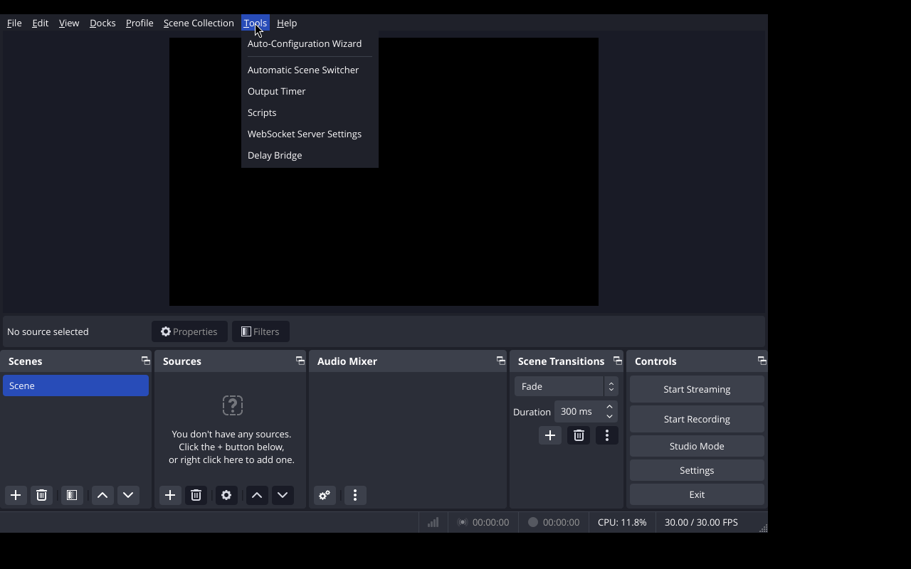

# OBS setup guide

This walks through everything from download to your first delayed stream, with the exact OBS menus. It takes about 5 minutes. Optional extras (hotkey, overlay scene, dock, viewer badge) come at the end.

Written for **OBS Studio 30 and 31** on Windows; macOS and Linux menus are the same. Streamlabs Desktop has [its own section](#streamlabs-desktop).

---

## 1. Install Delay Bridge

Go to the [latest release](https://github.com/HolyJSP/delay-bridge/releases/latest) and download the zip for your system, or [build it yourself](../README.md#building-from-source) with `build.bat` / `./build.sh`:

- Windows: `delay-bridge-windows-x64.zip`
- Mac (Apple Silicon and Intel): `delay-bridge-macos-universal.zip`
- Linux: `delay-bridge-linux-x64.zip`

Unzip it, then choose **A** (recommended) or **B**.

### A. As an OBS plugin (recommended)

The plugin starts Delay Bridge hidden in the background whenever OBS opens and stops it when OBS closes. It adds a **Delay Bridge dock** inside OBS, native OBS hotkeys and a **Tools → Delay Bridge** menu entry, and it can set everything up from the stream settings you already have in OBS.

1. **Close OBS completely.**
2. Open the **`obs-plugin`** folder from the zip:
   - **Windows:** double-click **`install-obs-plugin.bat`**. Or install by hand: copy the **`obs-delay-bridge`** folder into **`C:\ProgramData\obs-studio\plugins`** (ProgramData is hidden, so paste that path into File Explorer's address bar; create the `plugins` folder if it isn't there). You should end up with `C:\ProgramData\obs-studio\plugins\obs-delay-bridge\obs-delay-bridge.dll`. No admin rights needed.
     *Portable OBS:* copy the folder into the `plugins` folder of your portable OBS instead.
   - **macOS:** run `./install-obs-plugin.sh`, or copy **`obs-delay-bridge.plugin`** into `~/Library/Application Support/obs-studio/plugins` (Finder → Go → Go to Folder…).
   - **Linux:** run `./install-obs-plugin.sh`, or copy the **`obs-delay-bridge`** folder into `~/.config/obs-studio/plugins` (Flatpak: `~/.var/app/com.obsproject.Studio/config/obs-studio/plugins`).
3. **Start OBS.** A **Delay Bridge** dock appears. If you don't see it, use **Docks → Delay Bridge**.
   To check the plugin loaded: the **Tools** menu should have a **Delay Bridge** entry.
4. **One-click setup:** in the dock's **OBS** card, click **Use Delay Bridge with my Twitch settings** (or YouTube, Kick…). This copies your server and stream key from OBS into Delay Bridge and switches OBS's stream setting to Delay Bridge. **That replaces steps 2 and the "Stream" part of step 3 below.** Still do the keyframe interval in step 3.

   *No stream key in OBS yet?* Enter it in OBS (**Settings → Stream**) first, or type it in the dock's **Settings** tab instead.

   

> To uninstall, delete the `obs-delay-bridge` folder (`obs-delay-bridge.plugin` on macOS) from OBS's `plugins` folder, or run `uninstall-obs-plugin.bat` on Windows.
>
> Why ProgramData and not `C:\Program Files\obs-studio\obs-plugins\64bit`? OBS 33 marks plugins in that old location as legacy and OBS 34 stops loading them. Version 1.2.0 and earlier of this installer used it; running the new installer moves the plugin over.

### B. As a standalone program

1. Unzip it into a folder you'll keep, for example `Documents\Delay Bridge`. Your settings (`config.json`) are saved in that folder.
2. Double-click **`delay-bridge.exe`** (on Mac/Linux, run `./delay-bridge`). A small console window opens and the dashboard opens in your browser. Keep the window open while you stream.

   You should see:
   ```
     Delay Bridge 1.0.0 is running
     OBS server:  rtmp://127.0.0.1:1935/live
     Dashboard:   http://127.0.0.1:8080
   ```

**Tip:** to start it with Windows, press `Win + R`, type `shell:startup`, and put a shortcut to `delay-bridge.exe` in that folder. If you don't want the dashboard to open each time, set `"openOnStart": false` under `"web"` in `config.json`.

> **Windows says "Windows protected your PC"?** The files aren't code-signed (signing certificates cost money), so SmartScreen doesn't recognize them yet. Click **More info → Run anyway**. If you'd rather not, [build it yourself](../README.md#building-from-source) from the source code.
>
> **Mac says it "can't be opened"?** Right-click the file → **Open** → **Open**, or run `xattr -d com.apple.quarantine delay-bridge` once. The plugin installer does this for you.

## 2. Add your platform and stream key

*Plugin users: one-click setup (step 4 above) already did this. Skip to [Output](#output-keyframe-interval-important).*

1. The dashboard opens by itself the first time. If not, open **<http://127.0.0.1:8080>** in any browser (with the plugin: **OBS → Tools → Delay Bridge**).
2. Click **Settings** at the top.
3. Under **Where to stream**, fill in the Server URL and Stream key:

   | Platform | Server URL | Where to find the stream key |
   |---|---|---|
   | **Twitch** | `rtmp://live.twitch.tv/app` | [Creator Dashboard](https://dashboard.twitch.tv) → **Settings → Stream** → *Primary Stream key* → Copy |
   | **YouTube** | `rtmp://a.rtmp.youtube.com/live2` | [YouTube Studio](https://studio.youtube.com) → **Create → Go live → Stream** → *Stream key* |
   | **Kick** | copy the **Stream URL** (starts with `rtmps://`) | [Kick Creator Dashboard](https://dashboard.kick.com) → **Settings → Stream URL & Key** |
   | Other | the RTMP/RTMPS URL your platform gives you | your platform's stream settings |

4. Click **Save settings**. You can close the browser tab now; it isn't needed while you stream. With the plugin, the dashboard won't open on its own any more once a key is saved; use **Tools → Delay Bridge** when you want it.

Multistreaming? Click **+ Add destination** for each extra platform.

> ⚠️ Your stream key is like a password. It's stored only in `config.json` on your PC. Don't share that file or show it on stream.

## 3. Point OBS at Delay Bridge

Open OBS → **File → Settings** (or the **Settings** button bottom-right).

### Stream

**Settings → Stream**

| Field | Value |
|---|---|
| Service | **Custom…** |
| Server | `rtmp://127.0.0.1:1935/live` |
| Stream Key | `live` (anything works) |
| Use authentication | unchecked |

> Switching to *Custom* means OBS no longer streams to Twitch directly. Delay Bridge does that for you. To go back to normal later, set the Service back to Twitch.

### Output: keyframe interval (important)

In **Gradually** mode (the default) the keyframe interval doesn't matter for delay changes. In **Frozen frame** and **Overlay** modes, delay changes snap to keyframes, so they need to be frequent. A 2 s interval is a good setting either way (platforms recommend it).

**Settings → Output**, then look at **Output Mode** at the top:

1. Set **Output Mode** to **Advanced**. Simple mode doesn't show this setting and leaves it on automatic.
2. On the **Streaming** tab, find **Keyframe Interval** (shown as *"Keyframe Interval (0=auto)"*) and set it to **2 s**, or **1 s** for snappier changes. Don't leave it at 0 (auto): x264 then uses up to 250 frames (about 8 s at 30 fps).

With the plugin, the dock shows the keyframe interval OBS is actually using while you're live, and warns you if it's not 1–2 s.

Leave everything else (encoder, bitrate, rate control) as it was. Twitch, YouTube and Kick all recommend a 2 s keyframe interval anyway.

### Advanced: turn off OBS's own delay

**Settings → Advanced → Stream Delay**: make sure **Enable** is **unchecked**. Delay Bridge replaces it, and leaving both on adds the delays together.

While you're here, keep **Automatically Reconnect** enabled (the default).

Click **OK** to save.

## 4. Go live and test

1. Make sure Delay Bridge is running. With the plugin it runs whenever OBS is open.
2. Click **Start Streaming** in OBS.
3. In the Delay Bridge window you should see `OBS connected` and then `Twitch: live` (or your platform's name).
4. Open the dashboard. **OBS → Delay Bridge** and your platform should both show a green dot and a bitrate.

**Try it:** pick **15 s** → **Turn on**. Watch your own stream on the platform (muted, in another tab): it shows a frozen frame for ~15 s, then continues 15 s behind you. Click **Remove delay** and it jumps back to live within a couple of seconds.

---

## Optional extras

### A. Hotkeys

**With the OBS plugin** (nothing else to set up):

1. **OBS → Settings → Hotkeys**.
2. Type **Delay Bridge** in the filter box at the top.
3. Click the box next to an action and press a key, for example `F9`:
   - **Delay Bridge: Toggle delay**: on (with your default delay and timer) / off
   - **Delay Bridge: Turn on delay**
   - **Delay Bridge: Remove delay**
   - **Delay Bridge: Add 5 minutes to timer**
4. **OK**. The keys work in-game too, like any OBS hotkey.

Set what "on" means (delay length and auto-off) in the dashboard: **Settings → Delay options → Default delay / Default auto-off**.

**Standalone program** (no plugin), using OBS's WebSocket server:

1. **OBS → Tools → WebSocket Server Settings**
   - Tick **Enable WebSocket server**.
   - Keep **Enable Authentication** on, click **Show Connect Info**, and copy the **Server Password**.
2. **Delay Bridge dashboard → Settings → OBS control**
   - Tick **Connect to OBS WebSocket**.
   - URL: `ws://127.0.0.1:4455` (default).
   - Paste the password → **Save settings**. The dashboard should show **OBS control (WebSocket): connected**.
3. In OBS, in the scene you play in, add a source: **+ → Text** → name it exactly **`Delay Toggle`** → leave the text empty → OK.
   *(Add it to each scene you want the hotkey to work in.)*
4. **OBS → Settings → Hotkeys** → find **Show 'Delay Toggle'** and **Hide 'Delay Toggle'** under your scene → give both **the same key**.

### B. Overlay scene instead of a frozen frame

1. In OBS create a new scene, for example **`Delay Overlay`**. Add an **Image** (or **Text**) source with what you want viewers to see while the delay builds up.
2. Set up the WebSocket connection, because overlay mode needs it even with the plugin: in OBS, **Tools → WebSocket Server Settings → Enable WebSocket server**, copy the password from **Show Connect Info**, then in the dashboard **Settings → OBS control**, tick **Connect to OBS WebSocket**, paste it, and save.
3. **Dashboard → Settings → Overlay scene** → click **Load scenes** and choose `Delay Overlay` → **Save**.
4. On the Control tab choose **"Your overlay scene"**, or set **Default mode** to *Overlay scene* so the hotkey uses it too.
5. For the cleanest capture, use a **Cut** transition (Scene Transitions dock → Cut).

When you add delay, OBS flips to the overlay scene for about 1–2 seconds, then back to your game. Viewers see the overlay until the delayed stream catches up.

### C. Control panel inside OBS

With the plugin, the **Delay Bridge** dock is added automatically (toggle it under **Docks → Delay Bridge**), and **Tools → Delay Bridge** opens the same page in your browser. If you removed the dock, or use the standalone program, add it by hand:


**OBS → Docks → Custom Browser Docks…** → Dock Name `Delay`, URL `http://127.0.0.1:8080/` → **Apply**. Drag the dock wherever you like. It stops updating while hidden, so it costs nothing when closed.

### D. "Delay on" badge for viewers

**Sources → + → Browser** → URL `http://127.0.0.1:8080/overlay`, width 1920, height 1080. Put it on top of your scene. It's transparent and only shows a small "Stream delay: 60s" badge while a delay is active.

Options: `http://127.0.0.1:8080/overlay?position=bottom-left&text=Anti-snipe%20delay%20{delay}`

### E. Stream Deck

Add **System → Website**, tick **GET request in background**, and use a URL such as:

- `http://127.0.0.1:8080/api/on?seconds=60&minutes=20`: 60 s delay for 20 minutes
- `http://127.0.0.1:8080/api/off`: remove delay
- `http://127.0.0.1:8080/api/toggle`: toggle using your defaults

The [README](../README.md#stream-deck) has more.

---

## Streamlabs Desktop

1. **Settings → Stream** → **Stream Type: Custom Streaming Server** (shown as *"Stream to custom ingest"* in some versions).
   - URL: `rtmp://127.0.0.1:1935/live`
   - Stream key: `live`
2. **Settings → Output**: if Output Mode is **Advanced**, set **Streaming → Keyframe Interval** to **2**.
3. **Settings → Advanced → Stream Delay**: off.
4. Streamlabs can't load OBS plugins, so use the **standalone program** (option B) and control it with a Stream Deck button, Streamer.bot, or AutoHotkey using the API URLs.

## Two-PC setups

Run Delay Bridge on the **streaming PC**, the one that sends to Twitch.

If OBS runs on a different PC than Delay Bridge:
1. In `config.json` on the Delay Bridge PC, set `"ingest": { "host": "0.0.0.0", ... }` and restart it.
2. In OBS, use `rtmp://<Delay-Bridge-PC-IP>:1935/live` as the server.
3. Set `ingest.streamKey` to something private and use it as OBS's stream key, so no one else on your network can publish.
4. Allow Delay Bridge through the Windows Firewall when asked (private networks only).

## Changing ports

If something else already uses port 1935 or 8080, edit `config.json` (`ingest.port`, `web.port`), restart Delay Bridge, and update the OBS server URL to match, for example `rtmp://127.0.0.1:1936/live`.

---

Stuck? See **[TROUBLESHOOTING.md](TROUBLESHOOTING.md)**.
